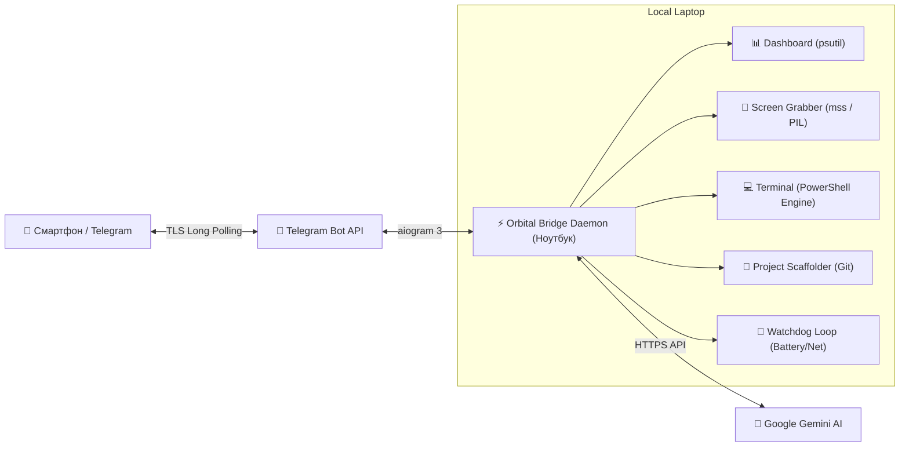

# 🛰️ Orbital Bridge

<p align="center">
  
  
  
  
  
</p>

> **Orbital Bridge** — персональный автономный мост между вашим смартфоном через Telegram и локальным ноутбуком/рабочей станцией. Управляйте системой, запускайте код, делайте скриншоты экрана и генерируйте проекты из любой точки мира.

---

## ⚡ Особенности

- 📊 **Живой дашборд железа:** мониторинг CPU, оперативной памяти, свободного места на SSD, заряда и статуса батареи ноутбука в реальном времени.
- 🌐 **Телеметрия сети:** непрерывный замер пинга, проверка доступности интернета и Gemini AI.
- 📸 **Удалённый снимок экрана:** моментальный захват экрана ноутбука (`/screen`) и отправка прямо в Telegram-чат.
- 💻 **Консоль терминала:** удаленное выполнение PowerShell / Bash команд с безопасным перехватом вывода, кодов возврата и форматированием.
- 📁 **Генератор проектов:** создание готовых проектов в один клик с шаблонами (`FastAPI`, `Python`, `Web`, `Empty`), авто-инициализацией `git init` и `.gitignore`.
- 🤖 **Встроенный AI-ассистент:** поддержка Google Gemini (2.5/3.8 Flash) прямо в чате для консультаций, написания скриптов и разбора логов.
- 🔔 **Watchdog-мониторинг:** фоновый сторожевой процесс уведомит о критическом разряде батареи (<20%) или восстановлении интернета после обрыва.
- 🛡️ **Защита доступа:** бот отвечает строго на авторизованный `ALLOWED_USER_IDS`.

---

## 🖥️ Интерфейс дашборда

```text
╔══════════════════════════════════════╗
║         ⚡ ORBITAL BRIDGE v1.0       ║
╚══════════════════════════════════════╝

🟢 Статус: В сети (Online)
⏱ Uptime ноута: 4д 5ч 14м (Обновлено: 18:55:02)

💻 СИСТЕМА
├─ CPU:  [■■■□□□□□□□] 28.4% (8 ядер)
├─ RAM:  [■■■■■□□□□□] 53.8% (8.6/16.0 GB)
├─ Диск: [■■■■■■■□□□] 124.5 GB свободно из 476.0 GB
└─ Батарея: ⚡ Заряжается (88%)

🌐 СЕТЬ И СЕРВИСЫ
├─ Интернет: 🟢 18.2 ms (Стабильно)
├─ Gemini AI: 🟢 Online (Gemini 2.5/3.8)
└─ Режим: 🛡️ Full Access (Owner Only)
```

---

## 🎮 Команды бота

| Команда | Описание |
| :--- | :--- |
| `/status` | Вызов интерактивного дашборда с кнопками быстрого действия |
| `/screen` | Сделать мгновенный скриншот экрана монитора и отправить фото |
| `/cmd <команда>` | Выполнить команду в терминале (PowerShell) и получить ответ |
| `/projects` | Просмотр списка локальных проектов и файлов в них |
| `/new_project <имя> [тип]` | Создать проект (`fastapi`, `python`, `web`, `empty`) с Git |
| `/chat <запрос>` | Задать вопрос AI (или просто отправить обычное сообщение) |
| `/help` | Показать подробную справку и примеры |

---

## 🚀 Быстрый запуск

### 1. Клонирование и настройка
```bash
git clone https://github.com/chembrovich-sa-case/orbital-bridge.git
cd orbital-bridge
```

### 2. Создание `.env`
Скопируйте пример:
```bash
copy .env.example .env
```
Заполните обязательные поля:
```ini
BOT_TOKEN=1234567890:ABCdefGHI...      # Токен от @BotFather
ALLOWED_USER_IDS=12345678              # Ваш Telegram ID (от @userinfobot)
GEMINI_API_KEY=AIzaSy...               # (Опционально) Google AI Studio ключ
```

### 3. Запуск

**В один клик (Windows):**
Просто дважды кликните по `run.bat` (он автоматически создаст виртуальное окружение, установит библиотеки и запустит демона).

**Вручную:**
```bash
python -m venv .venv
.venv\Scripts\activate
pip install -r requirements.txt
python -m src.bot
```

---

## 🏗️ Архитектура



---

## 🛡️ Безопасность

- Бот использует аутентификационный middleware: любые сообщения от пользователей, чей `user_id` отсутствует в `ALLOWED_USER_IDS`, немедленно блокируются.
- Токены хранятся исключительно в локальном файле `.env`, который добавлен в `.gitignore` и никогда не попадает в репозиторий.
- Соединение работает через исходящий HTTPS-запрос (Long Polling), поэтому открывать порты в роутере не требуется.

---

## 📄 Лицензия

MIT License © 2026 chembrovich-sa-case
